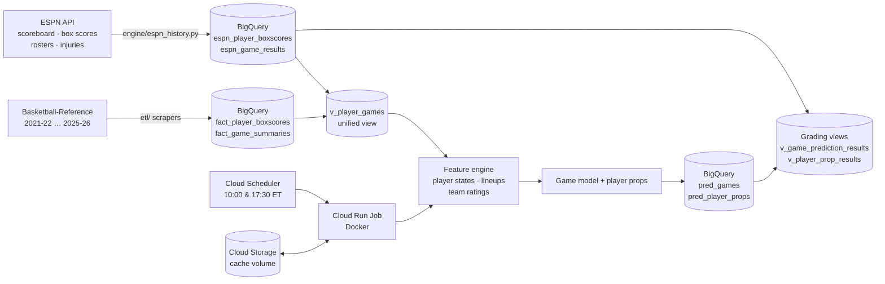

# 🏀 NBA Game & Player Prediction Platform

End-to-end **data engineering + machine learning** project on Google Cloud: a BigQuery
warehouse of five NBA seasons, a daily ingestion pipeline for the live season, a
player-based prediction model validated walk-forward on real outcomes, and a scheduled
serverless job that writes every prediction back to BigQuery for continuous grading.

The model itself is built only from box-score data; as a final, optional step its margin
and total are nudged toward the pre-game sportsbook line with a small fixed weight (25 %),
and the pure-model numbers are stored alongside for comparison.

---

## Architecture



| Layer | Implementation |
|---|---|
| Warehouse | BigQuery (EU): partitioned fact tables, unified view, ESPN↔BBRef id map |
| Ingestion | Basketball-Reference scrapers (historical), ESPN API client with on-disk cache (live season) |
| Features | Leakage-free player states (decayed, shrunk per-minute rates), lineup aggregation, ridge team ratings |
| Modeling | Ridge regression (game margin / total), XGBoost (player props), empirical conditional distributions |
| Serving | Cloud Run Job (Docker) + Cloud Scheduler, GCS-mounted cache, least-privilege service account |
| Tracking | Pre-tip-off predictions upserted to BigQuery; SQL views grade them as games finish |
| API / UI | FastAPI (`api/`), Next.js dashboard (`frontend/`, in progress) |

---

## Model

**1 · Player state** ([engine/features.py](engine/features.py)) – for every player and every
game, per-minute production of 14 box-score stats including on-court plus-minus,
exponentially weighted over his own previous games (half-life 20 games, across seasons)
and shrunk toward an "unknown player" prior (250 pseudo-minutes). Projected minutes =
EWMA of minutes played. All values use only games **before** the one being predicted.

**2 · Tonight's lineup** – ESPN roster minus players listed Out/Doubtful. Expected minutes
= P(plays) × minutes-when-playing, fitted to the 240-minute team total (bench absorbs
any excess, as coaches do) → a *projected team box score*.

**3 · Team ratings** ([engine/team_ratings.py](engine/team_ratings.py)) – opponent-adjusted
offense / defense / pace by recency-weighted ridge regression; pre-season prior =
previous season's final rating regressed 50 % to the mean.

**4 · Game model** ([engine/game_model.py](engine/game_model.py)) – ridge regressions fitted on
real final scores: margin and total from the home-minus-away (and summed) projected box
scores, rating margin/total/pace and back-to-backs; an in-season scoring-level
correction for totals; P(home win) = Φ(margin / σ).

**5 · Player props** – XGBoost per stat on rates × projected minutes plus team, opponent
and rating context (plain rate × minutes where boosting did not win on validation).
Each prop comes with a **predictive distribution** learned from out-of-sample residuals:
10th/90th percentiles and threshold probabilities (e.g. P(20+ points)), so role-player
"breakout" nights are priced realistically instead of assuming the stars always score most.

**6 · Market blend** ([engine/market.py](engine/market.py)) – final margin/total =
75 % model + 25 % pre-game sportsbook line (ESPN / DraftKings). On the 2026-27 season
(model out-of-sample) every metric improves with the market weight: margin MAE
11.00 → 10.93, log-loss 0.5815 → 0.5789; the market alone scores 10.83 / 0.5777.
The weight is deliberately limited so the model's own view stays visible
(`model_spread`, `model_total`, `model_home_win_prob` columns).

---

## Validation

Strictly walk-forward ([models/train.py](models/train.py), full report:
[models/evaluation_report.txt](models/evaluation_report.txt)):
hyper-parameters chosen on 2024-25, final fit on 2022-25, **tested on seasons never used
for any choice**.

**Games**

| Test season | Games | Winner accuracy | Log-loss | Brier | Margin MAE | Total MAE |
|---|---|---|---|---|---|---|
| 2025-26 | 1,230 | 69.7 % | 0.588 | 0.202 | 11.14 | 14.89 |
| 2026-27 (to date) | 248 | 69.4 % | 0.576 | 0.196 | 11.09 | 14.99 |

Baseline "home team always wins": 55.4 % / 52.0 %. Win probabilities are calibrated
(e.g. predicted 0.86 → observed 0.85). Ablation: lineup-only and ratings-only variants are
both worse than the combined model.

**Player props (2025-26)**

| Stat | MAE | Rate × minutes baseline | Correlation |
|---|---|---|---|
| Points | 4.46 | 4.53 | 0.74 |
| Rebounds | 1.85 | 1.92 | 0.68 |
| Assists | 1.34 | 1.34 | 0.70 |
| 3-pointers | 0.89 | 0.90 | 0.57 |

Distribution calibration, P(points ≥ 20): predicted 16.0 % vs observed 15.7 %;
role players (projection < 12) predicted 4.7 % vs observed 4.6 % in the 3–6 % bucket.

Known limits: back-tests use the players who actually appeared (no historical pre-game
injury reports exist), so live accuracy can be slightly lower; players with no NBA games
yet are not modelled.

---

## Running it

```bash
pip install -r requirements.txt
python -m engine.live_engine                  # today's slate (US Eastern date) -> BigQuery + output/
python -m engine.live_engine --days-ahead 1   # tomorrow's slate
python models/train.py                        # retrain + full validation report
uvicorn api.main:app --reload                 # REST API
bash deploy/gcp_deploy.sh                     # Cloud Run Job + Cloud Scheduler (idempotent)
```

Grading predictions in BigQuery:

```sql
SELECT COUNT(*) AS games, AVG(IF(winner_correct, 1, 0)) AS accuracy,
       AVG(spread_abs_error) AS margin_mae, AVG(log_loss) AS log_loss
FROM `nba_analytics.v_game_prediction_results`
WHERE actual_home_score IS NOT NULL;
```

---

## Repository

```
engine/        data access, ESPN client, features, ratings, models, live engine, BigQuery store
models/        training & validation script, trained models (JSON), evaluation report,
               season-long simulations (legacy pipeline, calibrated to market win totals)
etl/           Basketball-Reference scrapers and BigQuery loaders (historical warehouse)
sql/           BigQuery table schemas and views
api/           FastAPI service
frontend/      Next.js dashboard (work in progress)
deploy/        Google Cloud deployment script
Dockerfile     container for the Cloud Run Job
```

**Stack:** Python · pandas · NumPy · SciPy · XGBoost · BigQuery · Cloud Run Jobs ·
Cloud Scheduler · Cloud Storage · Cloud Build · Docker · FastAPI · Next.js
